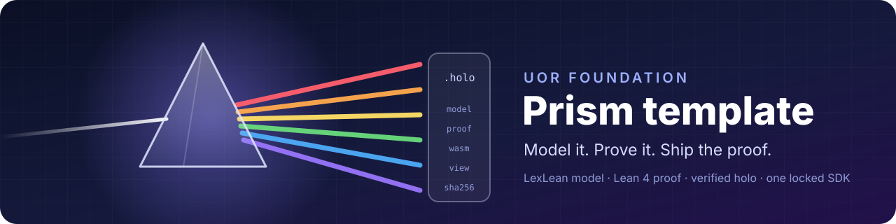

<p align="center">
  
</p>

<p align="center">
  <a href="https://github.com/new?template_owner=UOR-Foundation&amp;template_name=template"><b>Use this template</b></a>
  ·
  <a href="https://github.com/UOR-Foundation/PrismPM">PrismPM</a>
  ·
  <a href="https://github.com/UOR-Foundation/LexLean">LexLean</a>
  ·
  <a href="https://www.npmjs.com/package/prism-code">prism-code</a>
  ·
  <a href="https://github.com/UOR-Foundation/PrismPM/tree/main/docs/site">Docs</a>
  ·
  <a href="AGENTS.md">Agent rules</a>
</p>

<p align="center">
  <a href="https://github.com/UOR-Foundation/template/actions/workflows/bootstrap.yml"></a>
  
</p>

# UOR Prism template

The starting point for a Prism application: a repository whose every claim is
registered, specified as a scenario, tested, and accepted by one gate running
in one digest-pinned SDK.

A Prism application is modeled in [LexLean](https://github.com/UOR-Foundation/LexLean),
proved in Lean 4, and built by [PrismPM](https://github.com/UOR-Foundation/PrismPM)
into a holo: one content-addressed archive that holds the model, the proof, the
WebAssembly guest, its view and its build provenance. Anyone can check a holo
before it runs, offline, with [`prism-code`](https://www.npmjs.com/package/prism-code).
This template supplies everything around the model so you write only the model
and the claims it makes.

## Try it

- [Open the browser try page](https://uor-foundation.github.io/template/) — load, verify and run `Calculator.holo` entirely in the page, with no install.
- [](https://codespaces.new/UOR-Foundation/template?devcontainer_path=.devcontainer/try/devcontainer.json) — a terminal runs the Calculator and opens the port-8080 view.

## What you get

| Feature | What it means |
| --- | --- |
| **One gate** | `just vv` is the whole acceptance boundary, locally, in the devcontainer and in CI. Each check in it runs once. |
| **One SDK** | `prismpm.lock` pins the SDK image by digest for both `linux/amd64` and `linux/arm64`. Compiler, Lean, Rust, `cargo-deny` and `prismpm` all come from it. |
| **Claims you can audit** | `model/` registers every claim with an honesty level, and `CONFORMANCE.md` is generated from it. A claim without a scenario and a test fails the build. |
| **A scaffold for the discipline** | `just new-capability` writes the register row, the scenario and the failing test in the order the rules require. |
| **A minimal trust root** | `bootstrap.yml` has read-only permissions, no publication credentials, and is byte-bound by `template.lock`. |
| **A release pipeline** | `prismpm.yml` builds once, signs, promotes and deploys the same digest, with every step behind its own protected identity. |

## Get started

You need Git, Docker with Buildx, and a devcontainer client such as VS Code or
the `devcontainer` CLI. Nothing else is installed on the host.

1. **Create your repository.** Choose [Use this template](https://github.com/new?template_owner=UOR-Foundation&template_name=template), then clone it.
2. **Name it.** Set `workspace.package.repository` and `homepage` in `Cargo.toml`, and replace this README with your project's name and purpose.
3. **Open it in the devcontainer.** It runs the exact SDK image `prismpm.lock` selects.
4. **Run the gate.** `just vv` passes as cloned. It builds and verifies the template's own Prism application (below), so you start from a working, proved, shipped example.
5. **Add your first capability.**

   ```sh
   just new-capability CX-01 build parsing "A parsed document round-trips"
   ```

   This writes a row in `model/ids.toml`, a scenario in
   `features/suites/parsing.feature`, a failing test `parsing_cx_01` in
   `crates/conformance/tests/parsing.rs`, and the regenerated `CONFORMANCE.md`.
   Make the test assert the scenario, build the capability until it passes,
   plant the defect the test exists to catch, and run `just vv` again.

## Build from any device

`.github/workflows/build.yml` builds and verifies the app on a GitHub runner
and hands the holo back signed, so no machine of yours needs Docker, the SDK
image or a toolchain. The runner is not trusted; whoever takes the holo checks
it. Three ways in, one job:

- **From a phone or the web.** Commit an edit on github.com or GitHub Mobile.
  `pages.yml` runs the same SDK step, `prismpm verify` in the image
  `prismpm.lock` pins, signs the holo's provenance with
  `actions/attest-build-provenance`, and publishes the page, which verifies the
  holo again in the visitor's browser and links the signed provenance.
- **From a machine with Node.** `npx prism-code build --remote github` pushes
  the commit to `refs/heads/prism/build/<sha>`, waits for this workflow, and
  verifies the artifact `prism-build-<sha>` before writing anything under
  `app/.prism/build/`: the commit and repository it names, the holo's SHA-256,
  the provenance's subject and signer (a workflow of this repository through
  GitHub's OIDC issuer), the verdict, the fingerprint and every acceptance
  vector. Any of those failing is a typed refusal, not a build.
- **Run workflow**, from the Actions tab, for a branch.

`pages.yml` carries a copy of `build.yml`'s SDK and signing steps rather than
calling it: the gate pins every `uses:` to a commit and so forbids calling a
workflow by path. When one changes, copy it to the other. Pages on a private
repository needs a paid plan; the artifact and the summary need none.

## Publish the app page

`site/` is the standard Prism app page: a lean, installable PWA that loads the
holo `just app` builds, verifies it in the visitor's browser and puts the app
first. Every instance gets the same page; an app edits one file.

- **The workspace.** The page is a stage the height of the screen and never
  scrolls. A header row holds the app's name, one line under it, and View
  spec on the right. Below it, from 840 px, two panes: the app's surface on
  the left at full height, and a rail on the right with the result, the
  actions (a few of the holo's own examples, or the app's controls) and a
  history of what the visitor did, each entry one click from running again.
  An app with an input gets a display: what you type is the largest thing on
  screen, shrinking to fit as it grows, and the answer appears as you type,
  in the success colour when `app.json` calls it positive. Under 840 px the
  page is in focus mode: the surface takes the screen and one bar under it
  holds the result, then the actions, within thumb reach.
- **The spec, one click away.** View spec (or `.`, or a `#spec` link, or
  the shield's full details) opens a panel beside the window: the window
  and the bar narrow by its width (the page sets `--prism-aside` on
  `<html>`, which the frame reads) and nothing in the app moves or scales; on
  a phone the spec takes the screen. It reads in the order a newcomer asks:
  the promise and the three facts behind it (proved for every input,
  tested by the examples it carries, sealed to bytes in and bytes out), each
  theorem as it reads with its method and the rules it names (opened in
  place, read from the LexLean source under `app/src`), then the package:
  what goes in and out, every example replayed here, the fingerprint and the
  build chain. `page.mjs` renders it at build to `site/spec.html`, from
  the holo and its source; `site/spec.mjs` and `site/spec.css` load the
  first time it opens, so a visitor who only uses the app never loads them.

- **`site/app.json`** is the only file an app writes: its name, purpose and
  labels, the promise (`{ "headline", "detail" }`: one plain sentence a
  newcomer reads first, no code names, and the rule in everyday words), the
  claim, the proposition as it reads in the model, the theorems, the
  attestations, and the trusted set. Without a promise, the first plain
  sentence of the proposition stands in; `tagline` overrides the line under
  the name, which is otherwise the purpose's first sentence. `bootstrap/page.mjs` renders
  `site/index.html` and `site/manifest.webmanifest` from it; `bootstrap/icons.py`
  draws the icons (the Hologram logomark, the brand kit's 70 dots, on the warm
  ground, and `site/favicon.svg`, the mark as a vector that follows the
  browser's colour scheme, which the page carries inline as its favicon and
  its stand-in's mark, so neither costs a request), every app's default
  until it draws its own.
- **One live frame.** The frame every Prism app opens in (the top bar and
  the window the app shows through) is one web component, `<prism-frame>`, in `frame/`. On
  every push to `main`, `try-page.yml` publishes it to this repository's
  Pages site, named by its SHA-256, with a pointer:
  `https://uor-foundation.github.io/template/frame/current.json`. Every app
  page reads that pointer at run time, fetches the module it names, checks
  the bytes against the SHA-256 and only then runs it, so **a frame change
  in the template reaches every Prism app on its next load, with no app
  rebuilt.** Holo Search mounts the same element. Bytes that don't match
  the pointer never run: the page keeps its `holo://` address in the bar's
  reserved height, and the app itself still verifies and works. Offline,
  the service worker serves the last frame. `?frame=<sha256>` opens a page
  with one exact frame; `frame` in `app.json` names another frame host, for
  a test or a mirror. The frame draws in its own shadow root and brings the
  brand's tokens to a page that has none, so any host can mount it.
- **The page around it, locked.** Everything else on the page (the cards,
  renderer, loader, service worker and the page gates) is pinned by
  `frame.lock`, as `brand.lock` pins the brand: reviewed bytes that change
  only when an app chooses to. `node bootstrap/frame-sync.mjs --check` runs
  in `pages.yml` before the build, and an app takes a newer page with
  `--pin <template commit>`, which reads the template's `frame.lock` at that
  commit, fetches every file, refuses any whose bytes differ and records the
  pin. Which files a frame has is the target's to say: its `frame-sync.mjs`,
  matched to its lock, names them (inside `bootstrap/` and `site/` only), so
  a newer frame can add a file; one the target dropped is left in place and
  reported. A `frame-sync.mjs` older than this rule refuses a lock with files
  it does not know; fetch the target's script once, then pin:
  `curl -fo bootstrap/frame-sync.mjs https://raw.githubusercontent.com/UOR-Foundation/template/<commit>/bootstrap/frame-sync.mjs`.
  In the template, change these files and run `--lock`.
- **The brand is wired, not copied.** `brand.lock` pins
  [Hologram-Technologies/hologram-brand-kit](https://github.com/Hologram-Technologies/hologram-brand-kit)
  at one commit and records the SHA-256 of every file the page takes from it:
  the tokens (`site/brand/hologram-warm.css`, byte for byte) and the fonts
  (subset by `bootstrap/brand-fonts.py`, with metric-matched fallbacks).
  `node bootstrap/brand-sync.mjs --check` verifies the served files against the
  lock and runs in `pages.yml` before the build; `--pin <commit>` moves every
  app to a new kit revision. The page's own stylesheet declares no colour.
- **One frame, read like a browser.** Every app opens in the same frame: a
  46 px bar on the brand's chrome surface, and the app inside a rounded
  window inset 8 px from the screen's edges, as Lovable and Hologram OS show
  an app. The bar reads like Chrome's: home
  ([holo-search](https://humuhumu33.github.io/holo-search/)), then the
  address across the bar, the shield first, then `holo://` and the app's
  name in lower case with hyphens (`holo://luhn-check`), and the share icon
  at its right end; then GitHub (the app's repository), the theme, and full
  screen. Its icons are bare 16 px line drawings with a
  soft square tint on hover; on a touch screen each takes a 48 px tap
  beyond what it draws, so the bar is the same height everywhere. Under
  600 px GitHub steps out (the spec still links the repository); at large
  text the bar wraps and the window moves down with it. It is the live
  frame above: no app carries a copy of it.
- **Three themes: dark, immersive and light.** Plain dark, the brand's warm
  ground, is every new visitor's theme; a choice of immersive or light is
  remembered. The theme button
  shows the one in use (photo, moon or sun) and opens a panel to change it.
  Immersive is the dark ground with an Unsplash photo behind the app under
  a scrim, the rail frosted over it. The photo fills the app's window and
  stops at its edges and corners; the chrome around it never changes. A
  photo is never fetched with the page, which keeps every app inside its
  Lighthouse budget: one shown before comes from the browser's cache at
  once, and a new one arrives on the visitor's first move, its colour
  standing in until then.
  The frame draws all of it, so every Prism app and Holo Search has it with
  no rebuild. What only a visitor's move needs (every panel's styles, the
  theme panel and the photos) is a second module, `frame/panels.mjs` with
  `frame/panels.css`, published beside the frame and named by its SHA-256,
  which the frame carries: the frame fetches it after the first move,
  checks it and imports it, and a panel opened before then waits for it. Nine photos, space first, were chosen once and are published
  beside the frame (`frame/backdrops/`); the panel shows them by default, and
  the frame fetches the one in use from its own
  host, which every app page's `connect-src` already allows, and shows it
  as a `data:` image, which every `img-src` allows. No key ships, the panel
  credits each photographer, and nothing is fetched until the panel opens
  or immersive is chosen. The panel also searches Unsplash: results arrive
  as their colours, then fade in; choosing one sets it, tells Unsplash, and
  keeps it among the last three chosen. Search goes through the frame's
  worker (`frame/unsplash/`), which holds the key; the page build adds its
  origin to `connect-src`, and a page without it keeps the built-in photos.
- **The shield says why to trust the app.** As a browser's padlock does for
  a page, the shield sums what the visitor's browser found, and its panel
  shows each check: **Authentic** (every byte of the holo matches its
  fingerprint, shown with Copy), **Formally proved** (what the theorem
  guarantees, in one sentence, proved in Lean when the app was built, with
  its attestation) and **Behaves as proved** (every example the holo
  carries gives its proved answer here). Grey dots while it checks, green
  only when every check passed, red with the failing check named when one
  did not. Nothing is written by hand: `page.mjs` passes the promise's
  headline and the proof attestation from `app.json`, `app.mjs`
  passes the fingerprint check and the replay as they finish, and the
  frame draws the rest.
- **The bar holds still.** Until the frame's module arrives, the page shows
  a stand-in drawn as the bar will be: the Hologram mark and the address in
  its field, at the bar's height and in the page's theme, so the frame
  replaces it without anything moving. The stand-in is a few lines of the
  page's own CSS; writing the whole frame into every page cost about half a
  second of mobile LCP and broke the Lighthouse gate. A hop to an app the
  address bar suggested is prerendered, so it shows the full bar at once.
- **GitHub stars.** The GitHub icon in the address carries the repository's
  star count (128, 1.2k), written in at build and brought up to date from
  the Prism index on every load: no visitor's browser calls GitHub.
- **The Prism index, which every app joins by deploying.** One canonical
  kappa registry, at `registry.uor.foundation`, indexes every Prism app by
  its self-verifying address; the app's bytes stay on its own site. At the
  end of a GitHub Actions build, `page.mjs` runs `bootstrap/register.mjs`,
  which sends the registry the holo's fingerprint (its last 32 bytes) and the
  live page. The run proves its repository with the OIDC token GitHub mints
  for it, so there is no secret to hand out and a new app registers on its
  first deploy; `"index": false` in `app.json` opts out, and nothing here
  ever fails a build. The registry's indexer lists an app only when its live
  page serves a holo it registered, that holo verifies and every example
  passes; it then stores the app's address card in kappa
  (`prism/<owner>/<name>:blake3-<fingerprint>`: the fingerprint, SHA-256,
  size and where the bytes are), re-checks every app every ten minutes,
  finds new Prism apps on its own, and publishes a content-addressed
  snapshot (`/index/<sha256>.json`, named by `/index/current.json`) with
  each app's stars. Holo Search and every address bar read it downstream.
  The frame reads it at most once per page, and only when the visitor
  reaches for the bar (the GitHub pill under the pointer or in focus, or the
  address bar opened), never on load, so a page's first load keeps within
  its Lighthouse budget of two third-party requests; it checks the
  snapshot's SHA-256 before showing anything from it.
- **Hops between apps, ahead of the click.** A Prism app is named by its
  content, so a page loaded early is never stale and never another app's.
  When a visitor shows where they are going (home under the pointer, a
  suggestion chosen in the address bar) the frame marks that page with a
  `data-prism-ahead` link, and the page's one speculation rule (fixed, so
  `page.mjs` hashes it into the Content-Security-Policy) has the browser
  prerender it: the next app loads, verifies its bytes and replays its
  examples before the click, so opening it shows a page already checked.
  Another origin is prefetched; a browser without speculation rules gets a
  prefetch. Each page also opens the frame host's connection with its own,
  and holds the bar in place across the navigation with a cross-document
  view transition.
- **An address bar for Prism apps.** The holo:// pill is also an omnibox,
  like Chrome's. Focus it and it selects the address, a hairline in the UOR
  Foundation's colour spectrum runs round it, and it lists this app, every
  app in the Prism index (most stars first, each opening its own live page)
  and every entry in [Holo Search](https://humuhumu33.github.io/holo-search/)'s
  registry, one row each: the app's icon (its live page's, else its initial
  on a hue taken from its fingerprint, as a browser shows a site with no
  icon), its name, its address or short hash, and on the right its GitHub
  owner and stars. Type a name or a hash prefix to
  filter; paste a full address (a sha256 or blake3 digest, an IPFS CID, a
  Holo Search link) to open it. Enter hands it to Holo Search as `?r=`,
  which fetches the app, checks the bytes against the address and replays
  its examples before it opens: this page only suggests, Holo Search
  verifies. Arrows move, Escape backs out, and on a phone the bar takes the
  whole width while you type. The registry is fetched the first time the
  bar is focused, and the index with the page; the Content-Security-Policy admits
  Holo Search's origin for that request and the search form. Without a
  script, Enter still submits the form to Holo Search.
- **One Prism account, no password.** The person icon after full screen
  signs the visitor in with the device's own passkey (Face ID, Touch ID,
  Windows Hello, a phone), whose key never leaves its secure hardware. The
  account is named by its key's hash and the frame checks every signature
  in the browser, so no server is trusted to say who is signed in. See
  [identity/README.md](identity/README.md).
- **Made to be shared.** `bootstrap/og.py` draws `site/og.png`, the 1200 x
  630 card every platform shows for the link (the brand's dark ground, the
  mark, the app's name and purpose, "Proved in Lean. Verified in your
  browser."), from `app.json` and the page's own fonts. Run it whenever the
  name, purpose or live URL changes and commit the image; `page.mjs` refuses
  to render without it and writes the Open Graph and Twitter Card tags, all
  absolute on the live URL. On a phone the share button opens the system
  share sheet. Elsewhere it opens a panel with the card as the platforms
  will show it, the link to copy, and X, LinkedIn, Facebook and email (and
  the system sheet, where the browser has one). The card is fetched only
  when the panel first opens, never with the page.
- **The page is this app's, not the template's.** A repository created
  from the template starts with the template's `app.json`, social card and
  icons, and `bootstrap/page.mjs` refuses each until it describes this app.
  In CI, `app.json`'s `repository` must be the repository being built.
  `og.py` and `icons.py` stamp every PNG with a SHA-256 of what it was drawn
  from (the name, purpose and live URL, and the script's own bytes); the
  renderer recomputes the stamp from `app.json`, so a card or icon drawn for
  another app, left stale by an edit, or drawn by an older script never
  ships: run `python -I bootstrap/og.py` and `python -I bootstrap/icons.py`
  (after `node bootstrap/brand-sync.mjs --sync`, for the icons' font).
  `pages.yml` draws both before it renders, with Pillow pinned by hash in
  `bootstrap/draw-requirements.txt`, so publishing needs neither Python nor
  Pillow on the author's machine; drawing locally only refreshes the
  preview. An app pinning this page for the first time redraws both once. And
  `frame-sync.mjs --lock` runs only in this repository, so no app can bless
  its own copy of the page.
- **Any screen.** Material 3 window size classes: focus mode under 840 px,
  the workspace's two panes from 840; 16 px margins under 600 px and 24 px
  from it; 48 px touch targets on coarse pointers; safe areas; forced colours
  and reduced motion respected. `bootstrap/screens.mjs` holds every class
  in every theme to it, with the spec open and closed, and fails a page that
  scrolls.
- **An app's own surface.** An app that needs more than an input (a chess
  board) adds `site/card.html`, `site/card.css` and `site/card.mjs`. Each part
  of `card.html` names the workspace slot it fills with `data-slot`:
  `surface` (the stage, as large a square as fits), `result`, `actions` and
  `history` (the rail, `data-label` naming the last two), and `evidence`
  (the spec). A small script `page.mjs` hashes into the page moves each
  part into place before first paint, so nothing shifts; `card.mjs` is
  started with the verified app and finds its parts by id, as before.
- **Installable and offline.** A manifest with maskable icons and a service
  worker that caches every response as it passes, so the app loads, verifies
  the holo and answers requests with the network off after one visit. A new
  deploy shows one "Update available" chip and reloads only when asked.
- **The gate.** `lighthouserc.json` asserts 100 in performance, accessibility,
  best practices and SEO on the mobile profile, LCP under 1.5 s, TBT under
  100 ms, CLS 0, under 120 KiB and at most two third-party requests (the
  frame's pointer and module); `pages.yml` runs
  Lighthouse CI on the assembled site before anything is deployed.

`.github/workflows/pages.yml` checks the brand wiring on every push to
`main`, builds and verifies the holo through the locked SDK, signs its
provenance, renders the page with that holo and the provenance link, writes
the precache list, runs Lighthouse, and publishes to GitHub Pages. Turn Pages on
once, with the workflow as its source:

```sh
gh api -X POST repos/OWNER/NAME/pages -f build_type=workflow
```

The page is then at `https://OWNER.github.io/NAME/`. The workflow runs beside
`bootstrap`, not after it: `just app` is the proof-bearing build, so the page
goes live as soon as the Lean kernel has accepted the model.

## The template is a Prism application

`app/` is the **template contract checker**. A repository built from this
template inherits seven universal policy files that it must never edit. The
checker takes, for six of them, the digest `template.lock` pins and the digest
actually on disk, and answers `conformant` or names every file that drifted.

What makes it Prism and not a script: Lean proves the verdict is right.

```
theorem conformant_decides : conformant observation = true ↔ Conformant observation
```

`Conformant` says every observed digest equals its locked digest. The holo that
`prismpm verify` builds carries this proof, the WebAssembly guest that runs
the check, and the acceptance vectors it passed, so anyone can confirm the
checker before trusting its answer:

```sh
just app
npx prism-code inspect app/.prism/build/*/*.holo
```

The claim is registered as `TC-01`, specified in
`features/suites/contract.feature`, and pinned by the test `contract_tc_01`.
Keep it as a worked example of all three, or replace `app/src/Contract.lex.tex`
with your own model and `TC-01` with your own claims.

To see a larger Prism application, the
[Calculator](https://github.com/UOR-Foundation/PrismPM/tree/main/examples/Calculator)
in PrismPM is modeled, proved and built the same way, and `prism-code` ships it
as a sample holo:

```sh
npx prism-code inspect node_modules/prism-code/fixtures/Calculator.holo
npx prism-code vectors node_modules/prism-code/fixtures/Calculator.holo
```

## Everyday commands

| Command | What it does |
| --- | --- |
| `just vv` | The whole gate: format, model and audits, the SDK's template and lock checks, Clippy over every feature, the tests, `cargo deny`, and the Prism app's verified build. |
| `just app` | Checks the Prism application's model is canonical and locked, then builds and verifies its holo. |
| `just new-capability <ID> <level> <suite> "<statement>"` | Registers a capability with its scenario and failing test (R3). `level` is `build`, `open` or `some-true`. |
| `just model-write` | Regenerates `CONFORMANCE.md` from `model/`. |
| `just fmt` | Formats the workspace. |
| `just bdd` | Runs only the conformance meta-gate while you write scenarios. |

## Built from this template

- [MCP](https://github.com/UOR-Foundation/MCP): the Model Context Protocol, implemented as a server protocol core in LexLean and accepted only on MCP's own conformance oracles.
- [lexlean-mcp](https://github.com/UOR-Foundation/lexlean-mcp): serves LexLean to LLM clients over MCP, linking that protocol core unchanged.

## For coding agents

[AGENTS.md](AGENTS.md) holds the rules R1 to R6 and the required order of work.
Read it first. It is short, and every gate's failure message names the rule it
enforces, so a red `just vv` says which promise was broken.

## Repository layout

| Path | Owner | Purpose |
| --- | --- | --- |
| `app/` | project | The Prism application: its LexLean model, the Foundation library it imports, and its PrismPM manifest. |
| `model/` | project | The claim, authority and ledger registers: the single source of every claim (R1). |
| `features/suites/` | project | One Gherkin scenario per registered ID (R3). |
| `CONFORMANCE.md` | generated | Written by `just model-write`, never by hand. |
| `crates/model`, `crates/conformance` | template | The register parser and the honesty meta-gate. |
| `xtask/` | template | The repository gates and the `new-capability` scaffold. |
| `AGENTS.md`, `VERIFICATION.md`, `.devcontainer/`, `.github/workflows/bootstrap.yml`, `prismpm.lock`, `template.lock`, `template-contract.json` | universal policy | Byte-bound by `template.lock`. Changes arrive only as a reviewed template update. |

[TEMPLATE-CONTRACT.md](TEMPLATE-CONTRACT.md) defines the inherited policy and
the immutable SDK and template update process.
[VERIFICATION.md](VERIFICATION.md) defines the acceptance boundary, and
[TEMPLATE-VERIFICATION.md](TEMPLATE-VERIFICATION.md) maps this repository's
gates and their planted defects. Do not substitute a vendored PrismPM checkout
or a host toolchain for the locked SDK, and do not enable publication or
deployment before the project model and its acceptance criteria exist.

Licensed under [MIT](LICENSE-MIT) or [Apache-2.0](LICENSE-APACHE).
