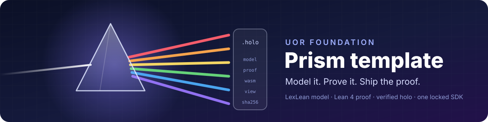

<p align="center">
  
</p>

<p align="center">
  <a href="https://github.com/new?template_owner=UOR-Foundation&amp;template_name=template"><b>Use this template</b></a>
  ·
  <a href="https://github.com/UOR-Foundation/PrismPM">PrismPM</a>
  ·
  <a href="https://github.com/UOR-Foundation/LexLean">LexLean</a>
  ·
  <a href="https://www.npmjs.com/package/prism-code">prism-code</a>
  ·
  <a href="https://github.com/UOR-Foundation/PrismPM/tree/main/docs/site">Docs</a>
  ·
  <a href="AGENTS.md">Agent rules</a>
</p>

<p align="center">
  <a href="https://github.com/UOR-Foundation/template/actions/workflows/bootstrap.yml"></a>
  
</p>

# UOR Prism template

The starting point for a Prism application: a repository whose every claim is
registered, specified as a scenario, tested, and accepted by one gate running
in one digest-pinned SDK.

A Prism application is modeled in [LexLean](https://github.com/UOR-Foundation/LexLean),
proved in Lean 4, and built by [PrismPM](https://github.com/UOR-Foundation/PrismPM)
into a holo: one content-addressed archive that holds the model, the proof, the
WebAssembly guest, its view and its build provenance. Anyone can check a holo
before it runs, offline, with [`prism-code`](https://www.npmjs.com/package/prism-code).
This template supplies everything around the model so you write only the model
and the claims it makes.

## What you get

| Feature | What it means |
| --- | --- |
| **One gate** | `just vv` is the whole acceptance boundary, locally, in the devcontainer and in CI. Each check in it runs once. |
| **One SDK** | `prismpm.lock` pins the SDK image by digest for both `linux/amd64` and `linux/arm64`. Compiler, Lean, Rust, `cargo-deny` and `prismpm` all come from it. |
| **Claims you can audit** | `model/` registers every claim with an honesty level, and `CONFORMANCE.md` is generated from it. A claim without a scenario and a test fails the build. |
| **A scaffold for the discipline** | `just new-capability` writes the register row, the scenario and the failing test in the order the rules require. |
| **A minimal trust root** | `bootstrap.yml` has read-only permissions, no publication credentials, and is byte-bound by `template.lock`. |
| **A release pipeline** | `prismpm.yml` builds once, signs, promotes and deploys the same digest, with every step behind its own protected identity. |

## Get started

You need Git, Docker with Buildx, and a devcontainer client such as VS Code or
the `devcontainer` CLI. Nothing else is installed on the host.

1. **Create your repository.** Choose [Use this template](https://github.com/new?template_owner=UOR-Foundation&template_name=template), then clone it.
2. **Name it.** Set `workspace.package.repository` and `homepage` in `Cargo.toml`, and replace this README with your project's name and purpose.
3. **Open it in the devcontainer.** It runs the exact SDK image `prismpm.lock` selects.
4. **Run the gate.** `just vv` passes as cloned. It builds and verifies the template's own Prism application (below), so you start from a working, proved, shipped example.
5. **Add your first capability.**

   ```sh
   just new-capability CX-01 build parsing "A parsed document round-trips"
   ```

   This writes a row in `model/ids.toml`, a scenario in
   `features/suites/parsing.feature`, a failing test `parsing_cx_01` in
   `crates/conformance/tests/parsing.rs`, and the regenerated `CONFORMANCE.md`.
   Make the test assert the scenario, build the capability until it passes,
   plant the defect the test exists to catch, and run `just vv` again.

## The template is a Prism application

`app/` is the **template contract checker**. A repository built from this
template inherits seven universal policy files that it must never edit. The
checker takes, for six of them, the digest `template.lock` pins and the digest
actually on disk, and answers `conformant` or names every file that drifted.

What makes it Prism and not a script: Lean proves the verdict is right.

```
theorem conformant_decides : conformant observation = true ↔ Conformant observation
```

`Conformant` says every observed digest equals its locked digest. The holo that
`prismpm verify` builds carries this proof, the WebAssembly guest that runs
the check, and the acceptance vectors it passed, so anyone can confirm the
checker before trusting its answer:

```sh
just app
npx prism-code inspect app/.prism/build/*/*.holo
```

The claim is registered as `TC-01`, specified in
`features/suites/contract.feature`, and pinned by the test `contract_tc_01`.
Keep it as a worked example of all three, or replace `app/src/Contract.lex.tex`
with your own model and `TC-01` with your own claims.

To see a larger Prism application, the
[Calculator](https://github.com/UOR-Foundation/PrismPM/tree/main/examples/Calculator)
in PrismPM is modeled, proved and built the same way, and `prism-code` ships it
as a sample holo:

```sh
npx prism-code inspect node_modules/prism-code/fixtures/Calculator.holo
npx prism-code vectors node_modules/prism-code/fixtures/Calculator.holo
```

## Everyday commands

| Command | What it does |
| --- | --- |
| `just vv` | The whole gate: format, model and audits, the SDK's template and lock checks, Clippy over every feature, the tests, `cargo deny`, and the Prism app's verified build. |
| `just app` | Checks the Prism application's model is canonical and locked, then builds and verifies its holo. |
| `just new-capability <ID> <level> <suite> "<statement>"` | Registers a capability with its scenario and failing test (R3). `level` is `build`, `open` or `some-true`. |
| `just model-write` | Regenerates `CONFORMANCE.md` from `model/`. |
| `just fmt` | Formats the workspace. |
| `just bdd` | Runs only the conformance meta-gate while you write scenarios. |

## Built from this template

- [MCP](https://github.com/UOR-Foundation/MCP): the Model Context Protocol, implemented as a server protocol core in LexLean and accepted only on MCP's own conformance oracles.
- [lexlean-mcp](https://github.com/UOR-Foundation/lexlean-mcp): serves LexLean to LLM clients over MCP, linking that protocol core unchanged.

## For coding agents

[AGENTS.md](AGENTS.md) holds the rules R1 to R6 and the required order of work.
Read it first. It is short, and every gate's failure message names the rule it
enforces, so a red `just vv` says which promise was broken.

## Repository layout

| Path | Owner | Purpose |
| --- | --- | --- |
| `app/` | project | The Prism application: its LexLean model, the Foundation library it imports, and its PrismPM manifest. |
| `model/` | project | The claim, authority and ledger registers: the single source of every claim (R1). |
| `features/suites/` | project | One Gherkin scenario per registered ID (R3). |
| `CONFORMANCE.md` | generated | Written by `just model-write`, never by hand. |
| `crates/model`, `crates/conformance` | template | The register parser and the honesty meta-gate. |
| `xtask/` | template | The repository gates and the `new-capability` scaffold. |
| `AGENTS.md`, `VERIFICATION.md`, `.devcontainer/`, `.github/workflows/bootstrap.yml`, `prismpm.lock`, `template.lock`, `template-contract.json` | universal policy | Byte-bound by `template.lock`. Changes arrive only as a reviewed template update. |

[TEMPLATE-CONTRACT.md](TEMPLATE-CONTRACT.md) defines the inherited policy and
the immutable SDK and template update process.
[VERIFICATION.md](VERIFICATION.md) defines the acceptance boundary, and
[TEMPLATE-VERIFICATION.md](TEMPLATE-VERIFICATION.md) maps this repository's
gates and their planted defects. Do not substitute a vendored PrismPM checkout
or a host toolchain for the locked SDK, and do not enable publication or
deployment before the project model and its acceptance criteria exist.

Licensed under [MIT](LICENSE-MIT) or [Apache-2.0](LICENSE-APACHE).
